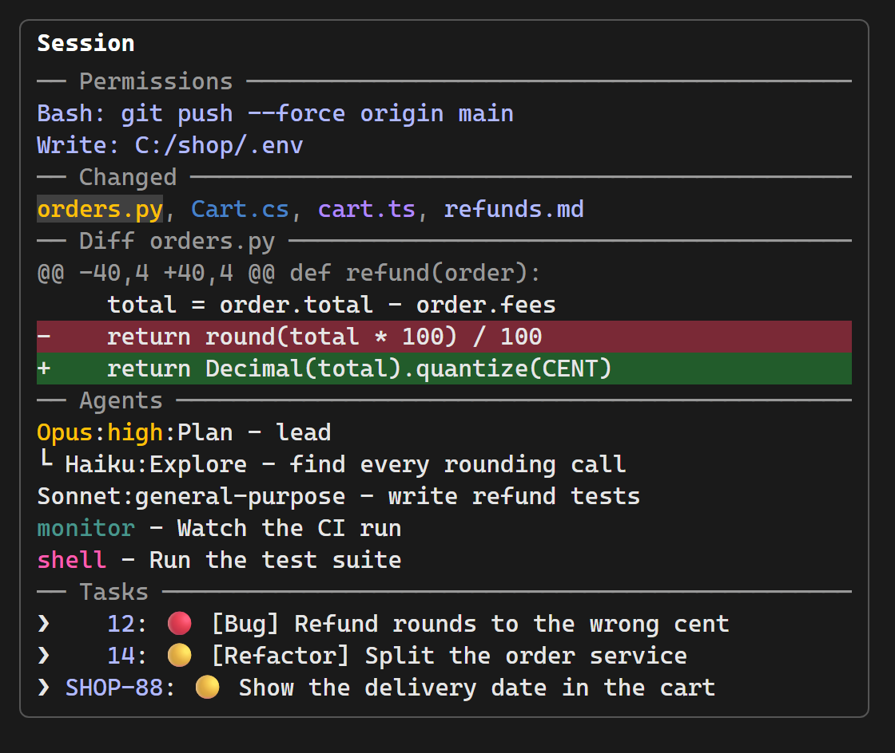

# session-pane

A Claude Code pane beside the chat that shows what the session does now. It refreshes every 2 seconds.



| Part | Shows |
|---|---|
| Permissions | Calls auto mode denied. A line drops out when a later call of the same tool and input is allowed, or when `/permissions` grants its command. |
| Changed | Files `git status` lists as changed or untracked, colored by file type. `*.stackdump` files are left out. Press a name to see its diff against `HEAD`; press again to close it. |
| Agents | Running agents as `<model>:<effort>:<agent type> - <name>`, model and effort colored by tier: Opus and `high`/`xhigh` yellow, Fable and `max` orange, others plain (effort left out when the agent takes the session's), sub agents indented under their parent, then background tasks as `<task> - <description>`, the task kind in its own color: `shell` pink, `monitor` teal, `workflow` blue. Each line stays one line, cut at the pane edge. |
| Tasks | Open tasks of the first task file found in the project, each led by `❯ ` and its id in the theme's suggestion color. |

A part with nothing to show is hidden. Press a file name or a line to highlight it and run its press action (see [Press actions](#press-actions)); press it again to clear it. Open the pane with `/session-pane`. It also opens when an interactive session starts.

## Install

```
/plugin marketplace add BenBellborn/session-pane
/plugin install session-pane@session-pane
```

## Options

Set them in `/config`, or in `settings.json` under `pluginConfigs["session-pane@session-pane"].options`.

| Option | Default | Meaning |
|---|---|---|
| `taskFiles` | `TODO.md, docs/TODO.md` | Comma-separated paths from the project folder. The first file found fills the Tasks part. |
| `taskFormat` | `checkbox` | `checkbox`: each open `- [ ] text` line. `heading`: each `## Task <id>: <title>` line. `custom`: `taskPattern`. |
| `taskPattern` | empty | With `taskFormat` `custom`: a regex that one task line matches, with a named group `title` and an optional named group `id`. |
| `showPermissions` | `true` | Show the Permissions part. |
| `showChanged` | `true` | Show the Changed part. |
| `showAgents` | `true` | Show the Agents part. |
| `showTasks` | `true` | Show the Tasks part. |

Example of a custom pattern for `TODO(a1): Ship it` lines: `^TODO\((?<id>\w+)\): (?<title>.*)$`.

## Press actions

The first session start writes `<config dir>/session-pane/config.json`. Edit it to set what a press does per item kind.
The pane reads it on each press, so an edit applies at once.

```json
{
  "onPress": {
    "changedFile": "diff",
    "task": "select",
    "permission": "select",
    "agent": "select"
  }
}
```

| Action | Does |
|---|---|
| `"select"` | Only highlights the item. |
| `"diff"` | Shows the changed file's diff against `HEAD` in a section under the Changed part. Changed files only. |
| `{"show": [argv], "format": "text"}` | Runs the command and shows its output in a section under the item's part. `format` `"diff"` colors it as a diff. |
| `{"run": [argv]}` | Starts a program, for example an editor. The pane does not wait for it. |
| `{"submit": "text"}` | Sends the text to Claude as a prompt. A text that starts with `/` runs that slash command. |
| `{"fill": "text"}` | Writes the text in the prompt box for you to edit and send. |

A command is an argument list, never a shell line: an item's text cannot run as a command.
A command runs in the repo folder for a changed file, otherwise in the project folder.

Placeholders in an argument or a text:

| Placeholder | Changed file | Task | Permission, Agent |
|---|---|---|---|
| `{text}` | path from the repo root | task line | line |
| `{file}` | full path | full path of the task file | - |
| `{path}` | path from the repo root | task file path from the project folder | - |
| `{line}` | first changed line | line of the task in its file | - |
| `{id}` | - | task id | - |
| `{root}` | project folder | project folder | project folder |

Examples:

```json
{
  "onPress": {
    "changedFile": { "run": ["code", "-g", "{file}:{line}"] },
    "task": { "run": ["notepad++", "-n{line}", "{file}"] },
    "permission": { "fill": "Why was this denied: {text}" },
    "agent": { "show": ["git", "log", "--oneline", "-5"] }
  }
}
```

A program that `run` starts ends with the session. To keep it open after the session, start it through the shell:
`["cmd", "/c", "start", "", "notepad++", "-n{line}", "{file}"]` on Windows, `["sh", "-c", "nohup code -g \"$0\" &", "{file}:{line}"]` elsewhere.
A bad config.json shows a `Config error` section when you press an item.

## Filter file

A tool can make the Tasks part show only some tasks, in its own order. It writes this file for the session:

```
<config dir>/cache/session-pane/<session id>.json
{"mode": "fix", "ids": ["46", "18"]}
```

- `<config dir>` is `CLAUDE_CONFIG_DIR` when set, otherwise `~/.claude`.
- `<session id>` is the `CLAUDE_CODE_SESSION_ID` environment variable of the session.
- `ids` are task ids, so the filter works only with a format that gives ids (`heading`, or a custom pattern with an `id` group).
- `mode` shows in the part's header: `Tasks (/fix)`.
- Delete the file to show every task again.
- Write a temporary file first, then rename it, so the pane never reads half a file.

## Test

From the repo folder: `claude plugin test`.

## License

MIT
